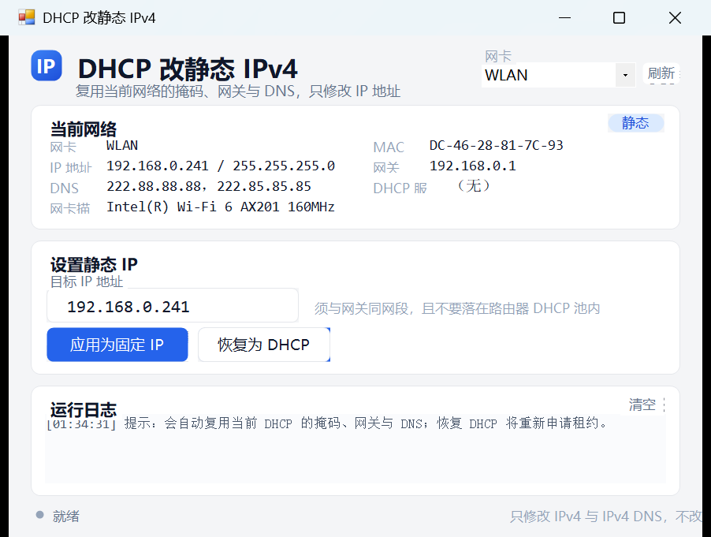

# DHCP 改静态 IPv4

一个给 Windows 用的桌面小工具：**把 IPv4 从 DHCP 自动获取改成固定 IP，其他信息（子网掩码 / 网关 / DNS）全部沿用当前网络设置，并可一键恢复 DHCP。**

## 它能做什么

- **自动读取当前 DHCP 信息**：网卡、MAC、IP、掩码、网关、DNS、DHCP 服务器，一屏展示；
- **一键改成固定 IP**：只改 IPv4 地址，掩码 / 网关 / DNS 自动复用当前 DHCP 拿到的值；
- **一键恢复 DHCP**：执行 netsh source=dhcp + ipconfig /renew，自动等待新租约并刷新显示；
- **安全检查**：IP 格式、是否与网关同网段、是否等于网关 / 广播地址、目标 IP 是否已被占用（ping 探测）；
- **无依赖、单文件**：.NET Framework 4.8（Win10/11 自带），不联网、不上传数据。

## 运行要求

- Windows 10 / Windows 11
- 管理员权限（程序清单声明了 requireAdministrator，双击会弹 UAC）

## 使用

1. 双击 DHCP改静态IPV4.exe，UAC 点「是」；
2. 选择网卡（一般只有 WLAN / 以太网）；
3. 在「目标 IP 地址」里填写想要的固定地址（已预填当前 IP），点 **应用为固定 IP**；
4. 想还原：点 **恢复为 DHCP**。

> 目标 IP 必须与默认网关同网段，且建议放在路由器 DHCP 地址池之外。例如：DHCP 池 192.168.0.100 - 192.168.0.240，本机固定用 192.168.0.241。

## 命令行（可选）

均需管理员权限：

~~~text
DHCP改静态IPV4.exe --info  --log info.txt
DHCP改静态IPV4.exe --set 192.168.0.241 --log set.txt
DHCP改静态IPV4.exe --dhcp  --log dhcp.txt
~~~

可加 --adapter "WLAN" 指定网卡；--shot preview.png 只渲染界面截图（开发用）。

## 自行编译

~~~powershell
# 使用系统自带的 C# 编译器（.NET Framework 4.8），无需安装任何 SDK
powershell -ExecutionPolicy Bypass -File src\build.ps1
~~~

源码在 src/：

| 文件 | 说明 |
| --- | --- |
| src/Program.cs | C# WinForms 全部源码（UI + 网络逻辑 + CLI） |
| src/app.manifest | 管理员权限 / DPI 感知 |
| src/app.ico | 程序图标 |
| src/build.ps1 | 编译脚本（输出到仓库根目录） |
| src/build-preview.ps1 | 编译非管理员预览版，方便调 UI（产物已忽略） |

## 设计说明

界面遵循「克制、清晰、有层次」的设计原则：

- 8pt 间距系统与卡片式布局，信息分为「当前网络 / 设置静态 IP / 运行日志」三块；
- 主按钮用品牌蓝并带 hover / pressed / disabled / focus 状态，次要按钮为描边样式；
- 输入框聚焦时描边高亮，错误与结果通过底部状态行 + 颜色点反馈，而不是弹窗打断；
- 技术值用等宽字体（Consolas），正文用 Microsoft YaHei UI；
- 操作进行中按钮禁用并显示「正在处理…」，日志保留完整 netsh 过程便于排查。

## 已知边界

- 只修改 IPv4 与 IPv4 DNS，不改 IPv6；
- 恢复 DHCP 后地址可能变化，依赖该 IP 的服务需要同步更新；
- 修改网络配置的瞬间会短暂断网（通常 1 到 3 秒）。

## 说明

本项目为个人自用工具，代码可自由参考。界面截图在 Windows 11 150% 缩放下截取。
